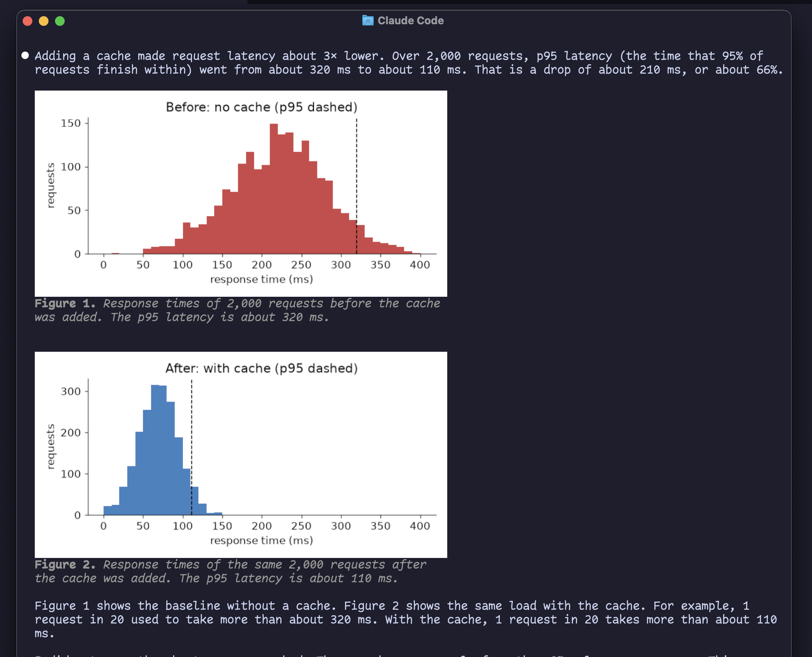

# image-peek

A Claude Code mod that draws PNG figures inline in the terminal, with numbered captions, the way a paper does.



- When a reply holds `` on its own line, the mod draws the picture there, with **Figure 3.** *What the figure shows.* under it.
- When Claude reads a PNG with the Read tool, the picture draws under the Read row, captioned with the file name.

## Install

At the prompt of a Claude Code session in a terminal:

```
/plugin install image-peek --marketplace marcoaaguiar/image-peek
```

Answer `y` to add the marketplace, then pick a scope.

## Tell Claude to use figures

`FIGURES.md` holds the instructions: when to draw a figure, how to number it through the session, how to caption it, and how to refer to it in the text ("see Figure 3"). Save it next to your `~/.claude/CLAUDE.md` and add this line to that file:

```
@FIGURES.md
```

## Open a figure

Click a caption to open the image at full size in your default viewer (Preview on macOS).

- A plain click works when Claude Code runs in fullscreen mode (`"tui": "fullscreen"` in `~/.claude/settings.json`).
- Cmd-click (Ctrl-click on Linux) works in every mode: the caption is also a link to the file. The terminal must support links (Ghostty, iTerm2, kitty and WezTerm do). Inside tmux, turn on the `hyperlinks` terminal feature, for example `set -as terminal-features ",xterm-ghostty:hyperlinks"`.

## Terminals

Pictures draw in Ghostty, kitty 0.28 or later, and iTerm2 3.5 or later. Elsewhere the caption shows as text.

Inside tmux (3.3 or later), turn on passthrough and focus events, then restart Claude Code:

```
set -g allow-passthrough on
set -g focus-events on
```

## Limits

PNG only, at most 2 MiB, absolute paths only.
